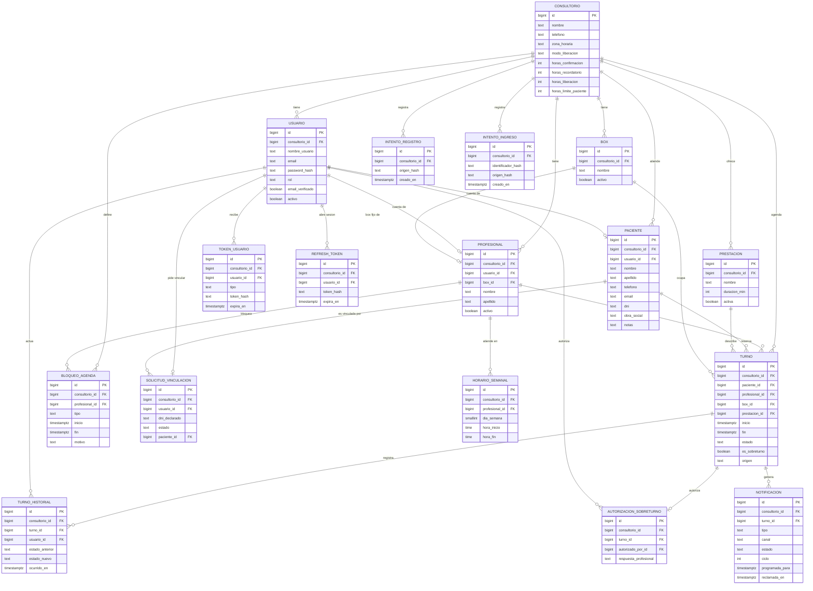

# Modelo de Datos

Modelo relacional para PostgreSQL, accedido mediante SQLAlchemy. Los nombres de tablas y columnas están en español (dominio) con términos técnicos en inglés.

## Principios

- **Preparado para varios consultorios.** Toda tabla que pertenece a un consultorio lleva `consultorio_id` (clave foránea a `consultorio`, no nula, con índice). En la v1 hay un único consultorio activo (RN-55 a RN-57). La única tabla sin `consultorio_id` es `consultorio`, que es el propio inquilino.
- **Aislamiento.** Toda consulta se filtra por el `consultorio_id` del token del usuario; en los flujos sin token lo resuelve el servidor y nunca lo envía el cliente (RN-59). Las claves únicas de negocio incluyen `consultorio_id`.
- **Fechas.** Instantes en `timestamptz` (UTC); la presentación usa `America/Argentina/Buenos_Aires` (SU-02, SU-36 en [09](09_decisiones_y_supuestos.md)). Horarios semanales en `time` sin zona, interpretados en la zona del consultorio.
- **Sin borrado físico** de turnos, pacientes ni usuarios: se cambia estado o se desactiva (`activo`). La v1 no tiene ninguna acción que desactive una ficha de paciente (SU-47).
- **Contraseñas** solo como hash (RN-04). Los tokens se guardan hasheados.
- **Auditoría.** `turno_historial` cubre los cambios de estado del turno. El aviso de privacidad y su aceptación están en la v1 (RN-65); la auditoría general y el circuito de derechos de la Ley 25.326 corresponden al change C-21, en la segunda parte de la entrega.

## Dominios

| Dominio | Entidades | Descripción |
|---------|-----------|-------------|
| Consultorio | `consultorio` | Inquilino y parámetros de operación. |
| Identidad y acceso | `usuario`, `token_usuario`, `refresh_token`, `intento_ingreso`, `intento_registro` | Cuentas, roles, verificación de correo, recuperación de contraseña, sesiones, los intentos de ingreso que sostienen el bloqueo por par cuenta y origen y el límite por origen (RN-09, DD-25) y los intentos de registro que sostienen el límite por origen (RN-62, DD-21). |
| Agenda | `profesional`, `box`, `horario_semanal`, `bloqueo_agenda`, `prestacion` | Quién atiende, dónde, cuándo y qué. |
| Pacientes | `paciente`, `solicitud_vinculacion` | Ficha mínima y pedidos de vinculación de una cuenta con una ficha preexistente. |
| Turnos | `turno`, `autorizacion_sobreturno`, `turno_historial` | Reservas, sobreturnos y trazabilidad. |
| Comunicación | `notificacion` | Correos y mensajes de WhatsApp programados, enviados o preparados. |

## ERD (Entity Relationship Diagram)



El diagrama resume las columnas clave. El detalle completo está en las secciones siguientes. La clave primaria de todas las tablas es `bigint` con identidad (`GENERATED BY DEFAULT AS IDENTITY`), decisión del dueño del proyecto del 2026-10-12 (DD-23 en [09](09_decisiones_y_supuestos.md)); las claves foráneas son `bigint`. Las claves foráneas no incluyen `consultorio_id`: que una fila no apunte a otra de otro consultorio lo garantizan los repositorios, que filtran siempre por `consultorio_id`, y un test por change que intenta la referencia cruzada (riesgo aceptado mientras exista un solo consultorio activo, DD-16). Los enums se guardan como `text` con una restricción `CHECK` (en SQLAlchemy, `Enum(..., native_enum=False, create_constraint=True)`) y no como tipos nativos de PostgreSQL, para que agregar un valor sea una migración común. El `MetaData` define una `naming_convention` para que todas las restricciones tengan nombre estable. La semilla inserta el consultorio con el identificador explícito de `CONSULTORIO_ACTIVO_ID` y después ajusta la secuencia de esa tabla para que el siguiente alta no choque.

## Entidades

### consultorio

Inquilino y parámetros de operación. En la v1 existe una única fila activa; en los flujos sin token el servidor la identifica con la variable de configuración obligatoria `CONSULTORIO_ACTIVO_ID`, que es el `id` de esta fila (RN-59).

| Columna | Tipo | Notas |
|---------|------|-------|
| `id` | PK | |
| `nombre` | text, no nulo | |
| `telefono` | text | Se muestra al paciente cuando ya no puede autogestionar (RN-33). |
| `direccion` | text, nulo | |
| `zona_horaria` | text, no nulo | Valor inicial `America/Argentina/Buenos_Aires`. |
| `modo_liberacion` | enum `automatico` \| `manual` | Por defecto `automatico` (RN-27, RN-28). |
| `horas_confirmacion` | int, no nulo | Valor inicial 48 (RN-25). |
| `horas_recordatorio` | int, no nulo | Valor inicial 24 (RN-26). |
| `horas_liberacion` | int, no nulo | Valor inicial 12 (RN-27). |
| `horas_limite_paciente` | int, no nulo | Valor inicial 24 (RN-33). La tabla exige el orden de los plazos con `CHECK (horas_confirmacion > horas_recordatorio AND horas_recordatorio > horas_liberacion AND horas_liberacion > 0 AND horas_limite_paciente > 0)`. |
| `minutos_granularidad` | int, no nulo | Valor inicial 15. Cada cuántos minutos se ofrece un horario de inicio, contados desde el inicio de cada bloque del horario semanal; también es la unidad de las duraciones ajustadas (RN-64). `CHECK (minutos_granularidad BETWEEN 5 AND 120)`. |
| `dias_anticipacion_maxima` | int, no nulo | Valor inicial 60. Hasta cuántos días hacia adelante puede reservar un paciente desde su cuenta (RN-64). `CHECK (dias_anticipacion_maxima >= 1)`. |
| `max_turnos_activos_paciente` | int, no nulo | Valor inicial 2. Turnos futuros `pendiente` o `confirmado` que un paciente puede tener reservados desde su cuenta (RN-64). `CHECK (max_turnos_activos_paciente >= 1)`. |
| `activo` | boolean | |

Los cuatro parámetros de horas se guardan por consultorio con los valores de las reglas como valor inicial (SU-25 en [09](09_decisiones_y_supuestos.md)).

### usuario

Cuenta de acceso de cualquier rol, incluido el paciente.

- Atributos: `id`, `consultorio_id`, `nombre_usuario` (text), `email` (text), `password_hash` (text), `rol` (enum `administrador` \| `recepcion` \| `profesional` \| `paciente` \| `administrativo`), `email_verificado` (boolean), `email_verificado_en` (timestamptz, nulo), `aviso_privacidad_aceptado_en` (timestamptz, nulo) y `aviso_privacidad_version` (text, nulo), que guardan cuándo aceptó el paciente el aviso de privacidad al registrarse y qué versión aceptó (RN-65); son nulos en las cuentas del personal, que crea el Administrador, con `CHECK ((aviso_privacidad_aceptado_en IS NULL) = (aviso_privacidad_version IS NULL))` y `CHECK (rol <> 'paciente' OR aviso_privacidad_aceptado_en IS NOT NULL)` (toda cuenta de paciente tiene su aceptación; el personal no puede tener una cuenta de rol `paciente`, y `POST /usuarios` la rechaza con 422), `activo` (boolean), `ultimo_ingreso_en` (timestamptz, nulo), `creado_en`, `actualizado_en`.
- Constraints: `UNIQUE (consultorio_id, nombre_usuario)`, `UNIQUE (consultorio_id, email)`. `nombre_usuario` y `email` se guardan normalizados: sin espacios al inicio ni al final y en minúsculas; la aplicación normaliza antes de escribir y antes de buscar (ingreso, registro, recuperación), y la base lo exige con `CHECK (nombre_usuario = lower(btrim(nombre_usuario)))` y `CHECK (email = lower(btrim(email)))`. Así `Ana@Ejemplo.com` y `ana@ejemplo.com` son la misma cuenta y la unicidad no distingue mayúsculas, sin sumar la extensión `citext`. Un solo `rol` por usuario (RN-08). Como la unicidad incluye `consultorio_id`, el ingreso, el registro y la recuperación de contraseña necesitan un consultorio sin tener token: lo resuelve el servidor y el cliente no lo envía (RN-59).
- Reglas: el personal lo crea el Administrador (RN-07); el paciente se autorregistra (RN-01) y no puede ingresar hasta verificar el correo (RN-02).
- Índices: los de las claves únicas.

### token_usuario

Tokens de un solo uso: verificación de correo, recuperación de contraseña y confirmación de turno por enlace (RN-03, RN-30).

- Atributos: `id`, `consultorio_id`, `usuario_id`, `ciclo` (int, nulo; solo para `confirmar_turno`: copia el `ciclo_confirmacion` del turno al emitir el enlace), `turno_id` (nulo; solo para `confirmar_turno`; la columna nace en C-02 sin clave foránea y la clave hacia `turno` la agrega la migración de C-07, que crea esa tabla), `tipo` (enum `verificar_email` \| `recuperar_password` \| `confirmar_turno`), `token_hash`, `expira_en`, `usado_en` (nulo), `creado_en`.
- Constraints: `UNIQUE (token_hash)`. El token en claro solo viaja en el enlace del correo y nunca se guarda.
- Índices: `(usuario_id, tipo)`, `expira_en`.

### refresh_token

Sesiones renovables (SU-27 en [09](09_decisiones_y_supuestos.md)).

- Atributos: `id`, `consultorio_id`, `usuario_id`, `token_hash`, `expira_en`, `revocado_en` (nulo), `reemplazado_por_id` (nulo), `creado_en`.
- Constraints: `UNIQUE (token_hash)`. Rotación en cada renovación.
- Índices: `(usuario_id)`.
- Las sesiones de una cuenta se cierran revocando todos sus refresh tokens (`revocado_en`) con el mismo caso de uso en dos situaciones: al restablecer la contraseña (RN-05) y al desvincular la cuenta de una ficha (RN-63).

### intento_ingreso

Un renglón por cada intento de ingreso, para bloquear de forma temporal el par cuenta y origen y para limitar los intentos de un mismo origen (RN-09, DD-25). El bloqueo no se guarda en `usuario`: así, quien falla la contraseña de otra persona solo se bloquea a sí mismo.

- Atributos: `id`, `consultorio_id`, `identificador_hash` (text), `origen_hash` (text, nulo), `creado_en` (timestamptz). No guarda el nombre de usuario, la contraseña ni la dirección.
- `identificador_hash` es `HMAC-SHA256`, con la clave `ORIGIN_HASH_SECRET`, del identificador enviado en el ingreso ya normalizado (sin espacios en los extremos y en minúsculas). Se calcula igual exista o no la cuenta, para que el bloqueo no revele qué cuentas existen. `origen_hash` se calcula como en `intento_registro` y es nulo cuando no se pudo determinar el origen: esos intentos comparten un mismo grupo por identificador.
- Índices: `(consultorio_id, identificador_hash, origen_hash, creado_en)` para el conteo del par, `(consultorio_id, origen_hash, creado_en)` para el conteo por origen y `(creado_en)` para la purga.
- Orden y conteo: primero la API inserta el renglón del intento y lo confirma en su propia transacción corta; después cuenta los renglones del par dentro de los últimos `LOGIN_LOCKOUT_MINUTES` y, si el conteo supera `LOGIN_MAX_ATTEMPTS`, responde el mismo 401 genérico de un ingreso incorrecto sin verificar la contraseña (los primeros 5 intentos del par se verifican; el sexto, aunque la contraseña sea correcta, ya no). Con el origen determinado cuenta además los renglones de ese origen, de todas las cuentas, dentro de la misma ventana y, si superan `LOGIN_MAX_ATTEMPTS_PER_ORIGIN` (20 por defecto), responde el mismo 401 sin verificar; con el origen nulo no rige el límite por origen. Un ingreso correcto borra los renglones de su par. Insertar y confirmar antes de contar hace que el intento cuente aunque la solicitud caiga o dos solicitudes lleguen a la vez; como en `intento_registro`, no hay un candado, porque el límite acota el abuso y no es una garantía de negocio: solicitudes simultáneas pueden superar el límite solo en la cantidad de solicitudes en vuelo. Un intento bloqueado también deja su renglón, de modo que quien insiste prolonga su propio bloqueo; el bloqueo termina solo, cuando los intentos salen de la ventana.
- Origen compartido: las personas que salen por la misma dirección (por ejemplo, la red del propio consultorio) comparten el origen. Alguien de esa red puede bloquear, durante la ventana, la cuenta de un empleado desde esa red; la cuenta sigue funcionando desde otro origen y el bloqueo termina solo. Con `TRUSTED_PROXY_HOPS=0` detrás del proxy de un host, todos los clientes comparten un origen: el bloqueo pasa a ser por cuenta y el límite por origen, global (lista de verificación de [12](12_devops_y_despliegue.md)).
- La ventana `LOGIN_LOCKOUT_MINUTES` no puede superar la retención de 24 horas: la configuración rechaza el arranque si excede 1.440.
- Retención: el barrido (C-15) borra los renglones de más de 24 horas, junto con los de `intento_registro`. Hasta que exista el barrido, cada inserción de un intento borra también los renglones de `intento_ingreso` de más de 24 horas, de todos los pares (usa el índice `(creado_en)`); C-15 reutiliza ese mismo caso de uso.

### intento_registro

Un renglón por cada solicitud de `POST /auth/registro` que pasó el control del límite, para contar los registros recientes por origen (RN-62, DD-21). Es la única tabla que guarda algo derivado de la dirección del cliente, y solo como hash.

- Atributos: `id`, `consultorio_id`, `origen_hash` (text, nulo), `creado_en` (timestamptz). No guarda la dirección, el DNI, el correo ni ningún dato del formulario.
- `origen_hash` es `HMAC-SHA256` de la dirección de origen con la clave del servidor `ORIGIN_HASH_SECRET`, en hexadecimal. Es nulo cuando no se pudo determinar el origen (ver [08](08_arquitectura_propuesta.md), "Límite de intentos y de abuso"): esos renglones cuentan para el límite global. Una dirección con hash sigue siendo un dato personal (RN-58).
- Constraints: ninguna adicional. Índices: `(consultorio_id, origen_hash, creado_en)` para el conteo y `(creado_en)` para la purga.
- Conteo: antes de registrar, la API cuenta los renglones del consultorio con el mismo `origen_hash` (con `origen_hash` nulo, los de origen no determinado) dentro de la ventana `REGISTRATION_LIMIT_WINDOW_MINUTES`; si el conteo alcanzó `REGISTRATION_LIMIT_PER_ORIGIN` (o `REGISTRATION_LIMIT_GLOBAL` para origen no determinado) responde 429 y no inserta nada; si no, inserta el renglón y lo confirma (`commit`) antes de que empiece la transacción del registro, en la misma sesión de la solicitud, y recién entonces sigue. Así el intento cuenta aunque después falle la validación o el registro: la reversión de la transacción del registro no arrastra el renglón. Dos solicitudes simultáneas pueden superar el límite en un renglón cada una; no hace falta un candado porque el límite acota el abuso y no es una garantía de negocio.
- Retención: el barrido (C-15) borra los renglones con `creado_en` anterior a 24 horas (operación repetible). Hasta que exista el barrido, cada inserción de un intento de registro borra también los renglones de más de 24 horas (usa el índice `(creado_en)`), y C-15 reutiliza ese mismo caso de uso. La ventana del límite no puede superar esa retención: la configuración rechaza el arranque si `REGISTRATION_LIMIT_WINDOW_MINUTES` excede 1.440.

### box

Consultorio físico donde atiende un profesional.

- Atributos: `id`, `consultorio_id`, `nombre`, `activo`.
- Constraints: `UNIQUE (consultorio_id, nombre)`.

### profesional

- Atributos: `id`, `consultorio_id`, `usuario_id` (FK a `usuario`, rol `profesional` o `administrador`: un administrador que también atiende tiene su agenda en su misma cuenta, DD-24; el rol de la cuenta no cambia), `box_id` (FK a `box`), `nombre`, `apellido`, `activo`.
- Relaciones: 1 usuario : 0..1 profesional; 1 box : 0..1 profesional (cada profesional tiene un box fijo, RN-10); 1 profesional : N horarios, bloqueos y turnos.
- Constraints: `UNIQUE (usuario_id)`, `UNIQUE (box_id)`. La unicidad de `box_id` codifica la regla del box fijo. Compartir un box entre profesionales sería un cambio de modelo, no de configuración.
- Dato no relevado: matrícula y especialidad quedan fuera de la v1 porque las fuentes no las piden.

### horario_semanal

Bloques de atención recurrentes por día de la semana. Un profesional puede tener varios bloques por día (por ejemplo, mañana y tarde).

- Atributos: `id`, `consultorio_id`, `profesional_id`, `dia_semana` (1 = lunes a 7 = domingo), `hora_inicio` (time), `hora_fin` (time).
- Constraints: `CHECK (hora_inicio < hora_fin)`. No se permiten bloques superpuestos del mismo profesional y día (validación de aplicación, RN-11).
- Índices: `(profesional_id, dia_semana)`.

### bloqueo_agenda

Excepciones por fecha que bloquean la agenda (RN-12). Cubre feriados, vacaciones, ausencias del profesional y bloqueos puntuales.

- Atributos: `id`, `consultorio_id`, `profesional_id` (nulo = aplica a todos los profesionales, por ejemplo un feriado), `tipo` (enum `feriado` \| `vacaciones` \| `ausencia` \| `bloqueo`), `inicio` (timestamptz), `fin` (timestamptz), `motivo` (text, nulo), `creado_por_id`, `creado_en`.
- Constraints: `CHECK (inicio < fin)`.
- Índices: `(profesional_id, inicio, fin)`.
- Un día completo se representa con `inicio` a las 00:00 y `fin` a las 24:00 del día en la zona del consultorio.

### prestacion

Catálogo editable de servicios con duración (RN-13).

- Atributos: `id`, `consultorio_id`, `nombre`, `duracion_min` (int, mayor que 0), `descripcion` (nulo), `activa`, `creada_en`.
- Constraints: `UNIQUE (consultorio_id, nombre)`, `CHECK (duracion_min > 0)`.
- No hay precios en la v1 (la facturación está en el backlog).
- Todas las prestaciones activas están disponibles para todos los profesionales (SU-24).

### paciente

Ficha mínima (RN-47). Puede existir sin cuenta (alta por Recepción) o vinculada a un `usuario` con rol `paciente`.

- Atributos: `id`, `consultorio_id`, `usuario_id` (nulo, único), `nombre`, `apellido`, `telefono`, `email`, `dni`, `obra_social` (text, nulo; solo dato, RN-51), `notas` (text, nulo), `activo`, `creado_en`, `actualizado_en`.
- Constraints: `UNIQUE (consultorio_id, dni)` (RN-48), `UNIQUE (usuario_id)`. El `dni` se guarda solo con dígitos (sin puntos ni espacios), con `CHECK (dni ~ '^[0-9]+$')`, para que la unicidad no dependa del formato; el `email` de la ficha se guarda normalizado igual que el de `usuario`.
- Índices: `(consultorio_id, apellido, nombre)`, `(consultorio_id, telefono)`.
- `activo`: la v1 no tiene ninguna acción que desactive una ficha. El indicador existe para fichas cargadas o corregidas fuera de la aplicación, y la acción de reactivar (abajo) existe para recuperar una ficha así (SU-47).
- Lectura de la cuenta vinculada (RN-63): el detalle de la ficha (`GET /pacientes/{id}`) incluye, solo para Recepción y Administrador, un bloque `cuenta` con el identificador del usuario, su `nombre_usuario`, su `email` y `email_verificado`, o nulo si la ficha no tiene cuenta (`usuario_id` nulo). No incluye otro dato de la cuenta (minimización, RN-58), y el Profesional y el Paciente no reciben el bloque.
- Vinculación con una ficha preexistente: no es automática; pasa por una `solicitud_vinculacion` que resuelve Recepción (RN-49, RN-62).
- Alta por el registro: la ficha se inserta con `INSERT ... ON CONFLICT (consultorio_id, dni) DO NOTHING RETURNING id`. Si no devuelve fila (el DNI ya tenía ficha, incluso una creada un instante antes por otro registro simultáneo), el registro sigue por el camino de la `solicitud_vinculacion` en la misma transacción, que no se aborta (RN-49, RN-62).
- Desvincular y reactivar (RN-63, DD-20; los hace Recepción o Administrador). En las dos acciones, igual que en vincular, una ficha que no existe en el consultorio responde 404 y no 409: desvincular lo sabe por su lectura previa, filtrada por `consultorio_id`, y reactivar, cuando su escritura no afecta ninguna fila, lo decide con una consulta de existencia filtrada por `consultorio_id` (404 si no existe, 409 si existe y ya estaba activa). Desvincular quita la cuenta de la ficha: `UPDATE paciente SET usuario_id = NULL WHERE id = :id AND consultorio_id = :consultorio AND usuario_id = :usuario_leido`, y si no afecta ninguna fila (la ficha no tiene cuenta, o otra operación la cambió entre la lectura y la escritura) responde 409 sin cambiar nada. El resto de la operación está en "Transiciones" de `solicitud_vinculacion`. Reactivar es `UPDATE paciente SET activo = true WHERE id = :id AND consultorio_id = :consultorio AND activo = false`; si no afecta ninguna fila (ya estaba activa) responde 409. Ninguna de las dos toca los datos de la ficha ni sus turnos.
- Dato personal: aplica la Ley 25.326 desde la v1 (RN-58).

### solicitud_vinculacion

Pedido de una cuenta de paciente que se registró con un DNI que ya tiene ficha en el consultorio (RN-49, RN-62). Se modela como tabla porque esa cuenta no tiene ficha propia donde guardar el pedido y así no se agregan columnas a `usuario` ni a `paciente`.

- Atributos: `id`, `consultorio_id`, `usuario_id` (FK a `usuario`, rol `paciente`), `dni_declarado` (text), `estado` (enum `pendiente` \| `vinculada` \| `rechazada`, inicial `pendiente`), `paciente_id` (FK a `paciente`, nulo; la ficha a la que está vinculada la cuenta o, con la solicitud `rechazada` tras una desvinculación, la ficha de la que se la desvinculó), `resuelta_por_id` (FK a `usuario`, nulo), `resuelta_en` (timestamptz, nulo), `motivo_rechazo` (text, nulo; el motivo del rechazo o de la desvinculación), `creada_en` (timestamptz).
- Constraints: `UNIQUE (usuario_id)` (una solicitud por cuenta). No es única por DNI: varias cuentas pueden declarar el mismo DNI y Recepción resuelve cada una.
- Índices: `(consultorio_id, estado, creada_en)` para la lista de pendientes; `paciente_id` (clave foránea).
- Invariante: una cuenta de paciente sin ficha (ninguna ficha tiene su `usuario_id`) tiene exactamente una solicitud, `pendiente` o `rechazada`; una cuenta con ficha tiene la solicitud `vinculada` o ninguna (la que se registró con un DNI nuevo y recibió su ficha en el registro). Por eso "cuenta sin ficha" y "solicitud `pendiente` o `rechazada`" nombran a las mismas cuentas en todos los documentos.
- Transiciones (cada una es una actualización condicional por el estado esperado, hecha por Recepción o Administrador). Ningún estado es final: la tabla de abajo es el recorrido completo, sin vuelta a `pendiente`.

  | Desde | Hacia | Quién o qué lo dispara | Efecto |
  |-------|-------|------------------------|--------|
  | `pendiente` o `rechazada` | `vinculada` | Vincular (`POST /solicitudes-vinculacion/{id}/vincular`) | Recepción elige la ficha destino (`paciente_id`; la lista sugiere la ficha cuyo DNI es `dni_declarado`, solo un dato informativo). Ver "Vincular" abajo. |
  | `pendiente` | `rechazada` | Rechazar (`POST /solicitudes-vinculacion/{id}/rechazar`, motivo opcional) | Es el resultado cuando la ficha ya pertenece a otra cuenta o Recepción no puede verificar la identidad. Ver "Rechazar" abajo. |
  | `vinculada` (o ninguna solicitud) | `rechazada` | Desvincular (`POST /pacientes/{id}/desvincular`, motivo obligatorio) | La cuenta queda sin ficha; si no tenía solicitud, se crea ya `rechazada`. Ver "Desvincular" abajo. |

  - **Vincular.** Se rechaza con 409, sin cambiar nada, si la ficha está inactiva (`activo = false`), si ya tiene otra cuenta o si el correo de la cuenta todavía no está verificado (`usuario.email_verificado`): la solicitud sigue como estaba. La transacción empieza bloqueando la fila de la ficha elegida (`SELECT id FROM paciente WHERE id = :paciente AND consultorio_id = :consultorio FOR UPDATE`): sin ese bloqueo inicial, la verificación de la clave foránea del paso 1 toma un bloqueo compartido sobre la ficha y dos vínculos simultáneos sobre la misma ficha se interbloquean en el paso 2. Si esa consulta no devuelve ninguna fila, la ficha no existe en el consultorio y la operación responde 404 sin cambiar nada. Después hace dos escrituras condicionales, en este orden, y exige que las dos afecten una fila: (1) primero la solicitud, `UPDATE solicitud_vinculacion SET estado = 'vinculada', paciente_id = :paciente, resuelta_por_id = :actor, resuelta_en = :ahora WHERE id = :id AND estado = :estado_leido AND estado IN ('pendiente', 'rechazada')`, donde `estado_leido` es el estado que Recepción vio; la segunda condición hace que una solicitud ya `vinculada` no afecte ninguna fila aunque eso sea lo que se leyó; y (2) después la ficha, `UPDATE paciente SET usuario_id = :usuario WHERE id = :paciente AND consultorio_id = :consultorio AND activo = true AND usuario_id IS NULL`. Si cualquiera no afecta ninguna fila, se revierte todo y responde 409: nada cambia, tampoco el estado de la solicitud. Escribir primero la solicitud hace que una solicitud ya `vinculada`, o que otra operación ya resolvió, responda 409 en el primer paso, antes de tocar la ficha. Toda violación de unicidad sobre `paciente.usuario_id` dentro de esta transacción (por ejemplo, una cuenta que ya tiene otra ficha por datos corregidos fuera de la aplicación) se traduce a 409 con reversión completa, de modo que ningún camino termina en un error de integridad sin traducir. Así dos vínculos simultáneos de cuentas distintas sobre la misma ficha dejan uno solo (el segundo espera en el bloqueo inicial de la fila de la ficha, ya no la encuentra sin cuenta y recibe 409, y la reversión incluye su paso 1: su solicitud sigue como estaba); dos resoluciones simultáneas de la misma solicitud, con la misma ficha o con fichas distintas, también (la segunda espera el bloqueo de la fila de la solicitud, ve que el estado cambió y recibe 409 en el primer paso; por ejemplo, un rechazo y un vínculo, o dos vínculos con fichas distintas); y un vínculo simultáneo con una desvinculación o una reactivación de esa ficha se ordena por el bloqueo de la fila de `paciente`, que las tres operaciones toman primero. Si aun así el motor informa un interbloqueo o un fallo de serialización (`40P01`, `40001`), se traduce también a 409 con reversión completa. Si el DNI de la ficha cambió después de la solicitud no hay conflicto, porque la ficha la elige Recepción tras verificar la identidad y no se compara con `dni_declarado`. Para una persona que no tiene ficha, Recepción crea una ficha nueva con `POST /pacientes` y la vincula con esta misma transición.
  - **Rechazar.** En la misma transacción, solo si el correo de la cuenta está verificado, se programa una `notificacion` `vinculacion_rechazada` (correo a la cuenta, sin el motivo ni el DNI) que le pide al paciente comunicarse con el consultorio, y se despacha de inmediato con el caso de uso de [`notificacion`](#notificacion) (el barrido lo reintenta). Si el correo no está verificado no se programa ninguna notificación (SU-42): el consultorio no escribe a una dirección que nadie probó controlar, y la cuenta, cuando verifique su correo, ve el rechazo de la reserva (403) con el mensaje de que debe comunicarse con el consultorio (RN-62). Rechazar una solicitud que ya no está `pendiente` responde 409 y no repite el correo.
  - **Desvincular.** En una transacción: (1) la escritura condicional de `paciente` descrita arriba (`usuario_id` pasa a nulo solo si sigue siendo el que se leyó; si no afecta ninguna fila, 409 y se revierte todo); (2) la solicitud de esa cuenta pasa a `rechazada` con `INSERT ... ON CONFLICT (usuario_id) DO UPDATE ... WHERE solicitud_vinculacion.estado = 'vinculada'`: conserva `paciente_id` (la ficha de la que se la desvinculó), guarda `motivo_rechazo` (el motivo obligatorio), `resuelta_por_id` y `resuelta_en`; si la cuenta no tenía solicitud porque recibió su ficha en el registro con un DNI nuevo, la solicitud se crea directamente `rechazada` con `dni_declarado` igual al DNI de la ficha en ese momento; si el `DO UPDATE` no afecta ninguna fila (la solicitud existente no está `vinculada`, lo que el invariante excluye) se revierte todo y responde 409; (3) se revocan todos los refresh tokens de la cuenta, con el mismo caso de uso del restablecimiento de contraseña (RN-05). No se programa ningún correo: no es un rechazo de una solicitud. Deja `rechazada` y no un estado nuevo porque es el único estado sin ficha desde el cual el modelo ya permite volver a `vinculada`, y así no se agregan estados ni columnas: `rechazada` con `paciente_id` no nulo identifica a la cuenta desvinculada. Dos desvinculaciones simultáneas de la misma ficha dejan una sola: la segunda no afecta ninguna fila y responde 409. El registro conserva solo la última resolución, igual que ya se definió: se pierde quién vinculó antes y cuándo; la auditoría general de la Ley 25.326 es el backlog (US-B01, RN-58).
  - Una cuenta desvinculada se vuelve a vincular con la misma transición `rechazada` → `vinculada`. El paciente no reintenta por su cuenta (no hay una segunda solicitud, por `UNIQUE (usuario_id)`, ni un formulario nuevo): Recepción dispone de una salida para cada caso (RN-63), pero que el paciente llegue a pedirla depende de que contacte al consultorio, y una cuenta con el correo sin verificar no recibe el correo de rechazo.
- Solo se guarda el DNI declarado: los demás datos del formulario de registro se validan y no se copian a la solicitud (minimización, RN-58). Recepción identifica a la persona con el correo de la cuenta y la ficha existente; la lista muestra además si el correo de la cuenta está verificado y, cuando la solicitud está `vinculada`, la ficha vinculada (su identificador, nombre y apellido); no devuelve más datos de la cuenta ni de la ficha (minimización, RN-58). Solo Recepción y Administrador la leen.
- La solicitud no se borra: cada intento de vincular una cuenta con una ficha existente queda registrado con su DNI declarado, su fecha y su resolución, y Recepción puede consultarlos sin filtrar por estado para detectar pedidos sospechosos, por ejemplo varias cuentas sobre el mismo DNI (RN-62). La resolución más reciente es la que conservan `resuelta_por_id` y `resuelta_en`; `motivo_rechazo` se conserva al vincular una solicitud antes rechazada o desvinculada.

### turno

Reserva de un paciente con un profesional.

| Columna | Tipo | Notas |
|---------|------|-------|
| `id` | PK | |
| `consultorio_id` | FK, no nulo | |
| `paciente_id` | FK, no nulo | |
| `profesional_id` | FK, no nulo | |
| `box_id` | FK, no nulo | Se copia del box fijo del profesional al crear. |
| `prestacion_id` | FK, no nulo | |
| `inicio`, `fin` | timestamptz, no nulos | `fin` es `inicio` más la duración de la prestación (RN-13) o, si el personal fijó otra para ese turno, `inicio` más esa duración, en múltiplos de `minutos_granularidad` (RN-64). Reprogramar conserva la duración actual del turno: una duración ajustada no se recalcula con la de la prestación, salvo que el personal fije otra (RN-64). `CHECK (inicio < fin)`. |
| `estado` | enum | `pendiente`, `confirmado`, `ausente`, `atendido`, `cancelado`, `liberado` (RN-18, RN-20). |
| `es_sobreturno` | boolean | Verdadero solo con autorización (RN-39). |
| `origen` | enum `online` \| `recepcion` | |
| `ciclo_confirmacion` | int, no nulo, inicial 1 | Se incrementa al reprogramar para reiniciar los hitos y la marca "sin confirmar" (RN-32). |
| `confirmacion_solicitada_en` | timestamptz, nulo | Hito de 48 h (RN-25). |
| `recordatorio_enviado_en` | timestamptz, nulo | Hito de 24 h (RN-26). |
| `confirmado_en` | timestamptz, nulo | |
| `marcado_sin_confirmar_en` | timestamptz, nulo | Marca "sin confirmar" del modo manual (RN-28) y del turno que no cumple las condiciones de la liberación automática (RN-60). No es un estado. Pertenece a un ciclo de confirmación: reprogramar la limpia (vuelve a nulo) junto con el incremento de `ciclo_confirmacion` (RN-32). Dentro de un mismo ciclo, un turno marcado no se vuelve a evaluar para la liberación automática aunque su solicitud de confirmación se envíe después: decide Recepción (RN-60). El barrido no selecciona ni marca un turno cuyo inicio ya pasó. |
| `liberado_en` | timestamptz, nulo | |
| `cancelado_en`, `cancelado_por_id`, `motivo_cancelacion` | nulos | RN-36. |
| `reprogramado_de_inicio` | timestamptz, nulo | Inicio anterior, para la última reprogramación. El detalle completo queda en el historial. |
| `notas` | text, nulo | |
| `creado_por_id` | FK a `usuario` | Paciente o personal. |
| `creado_en`, `actualizado_en` | timestamptz | |

Constraints e índices:

- **No solapamiento por profesional** (RN-17): restricción de exclusión en PostgreSQL sobre el rango de tiempo.

```sql
-- Requiere la extensión btree_gist (SU-28 en 09).
ALTER TABLE turno ADD CONSTRAINT turno_sin_solapamiento
  EXCLUDE USING gist (
    consultorio_id WITH =,
    profesional_id WITH =,
    tstzrange(inicio, fin, '[)') WITH &&
  )
  WHERE (es_sobreturno = false
         AND estado IN ('pendiente', 'confirmado', 'atendido', 'ausente'));
```

- Los turnos `cancelado` y `liberado` no ocupan el hueco (RN-22). Los sobreturnos quedan fuera de la restricción por diseño (RN-39). Como la restricción los ignora, no impide que un turno regular se cree encima de un sobreturno activo: lo impide la aplicación (RN-17). La disponibilidad trata un sobreturno activo como ocupado y crear o reprogramar un turno regular que se superponga con un sobreturno activo del mismo profesional se rechaza con 409 en el caso de uso; el control está en la aplicación y no en la base, y una carrera simultánea entre un sobreturno y un turno regular es un riesgo residual documentado.
- Candidatos del barrido para liberar o marcar "sin confirmar" (RN-60): turnos `pendiente`, sin marca, en su ciclo actual, con `inicio - horas_liberacion <= :ahora` y que todavía no comenzaron (`inicio > :ahora`). `:ahora` sale del puerto `Reloj`, no de `now()` de SQL. Un `pendiente` que ya comenzó queda fuera del conjunto candidato y no se reevalúa en cada barrido: el personal lo cierra como `atendido` o `ausente` (RN-44).
- Liberar y marcar "sin confirmar" desde el barrido (RN-60) son cada una una sola actualización condicional, `UPDATE turno SET ... WHERE id = :id AND estado = 'pendiente' AND marcado_sin_confirmar_en IS NULL AND ciclo_confirmacion = :ciclo AND inicio > :ahora`, que solo surte efecto si la fila sigue en la condición con que se evaluó, incluida "el turno no comenzó". La fila de `turno_historial` (`liberar` o `marcar_sin_confirmar`) se inserta en la misma transacción solo si esa actualización afectó una fila. Así, dos barridos simultáneos dejan una sola fila de historial y un solo aviso: no hace falta un estado intermedio ni un reclamo aparte, porque la propia actualización condicional es el reclamo.
- Índices: `(consultorio_id, profesional_id, inicio)`, `(consultorio_id, paciente_id, inicio)`, `(estado, inicio)` para los trabajos programados.
- Lectura del box: como cada profesional tiene un box fijo, validar por profesional equivale a validar por box. `box_id` se conserva en el turno para consultas y para no perder el dato si el profesional cambia de box en el futuro.

### autorizacion_sobreturno

Registro de quién autorizó un sobreturno y cómo respondió el profesional afectado (RN-39 a RN-42).

- Atributos: `id`, `consultorio_id`, `turno_id` (único), `autorizado_por_id` (FK a `usuario`, rol `recepcion` o `administrador`), `autorizado_en`, `motivo` (text), `profesional_notificado_en` (timestamptz), `respuesta_profesional` (enum `sin_respuesta` \| `aprobado` \| `rechazado`), `respondido_en` (nulo), `comentario_profesional` (nulo).
- Constraints: `UNIQUE (turno_id)`.

### turno_historial

Bitácora inmutable de cambios de estado y reprogramaciones del turno (RN-21). Es la base del indicador de ausentismo.

- Atributos: `id`, `consultorio_id`, `turno_id`, `usuario_id` (nulo cuando actúa el sistema), `accion` (enum `crear`, `confirmar`, `cancelar`, `liberar`, `atendido`, `ausente`, `reprogramar`, `sobreturno`, `marcar_sin_confirmar`, `corregir`), `estado_anterior`, `estado_nuevo`, `detalle` (jsonb, nulo), `ocurrido_en`.
- Solo se inserta, nunca se modifica ni se borra.
- Índices: `(turno_id, ocurrido_en)`, `(consultorio_id, ocurrido_en)`.

### notificacion

Calendario de comunicaciones y registro de su resultado. Es la fuente de verdad que procesa el barrido idempotente de la API (SU-26).

- Atributos: `id`, `consultorio_id`, `turno_id` (nulo para los correos de cuenta y para `vinculacion_rechazada`; la columna nace en C-05 sin clave foránea y la clave hacia `turno` se agrega cuando existen las dos tablas, ver C-07), `usuario_id` (nulo), `tipo` (enum `verificacion_email`, `recuperacion_password`, `vinculacion_rechazada`, `solicitud_confirmacion`, `recordatorio`, `liberacion`, `cancelacion_por_personal`, `reprogramacion_por_personal`, `resumen_reserva`, `cancelacion_por_paciente`), `canal` (enum `email` \| `whatsapp`), `estado` (enum `programada`, `enviando`, `enviada`, `fallida`, `preparada`, `enviada_manual`, `omitida`), `ciclo` (int, nulo; copia el `ciclo_confirmacion` del turno al programar un aviso de turno; nulo en los correos que no tienen turno), `destinatario` (text), `programada_para` (timestamptz), `reclamada_en` (timestamptz, nulo; la hora de la reclamación vigente, que identifica esa reclamación; solo con estado `enviando`), `enviada_en` (nulo), `intentos` (int; se incrementa en cada reclamación), `ultimo_error` (text, nulo), `mensaje` (text, nulo; para WhatsApp), `enlace_whatsapp` (text, nulo), `marcada_enviada_por_id` (nulo).
- Constraints: `CHECK ((estado = 'enviando') = (reclamada_en IS NOT NULL))`: la marca de la reclamación existe exactamente mientras la fila está `enviando`.
- Regla general de `reclamada_en`: toda transición que sale de `enviando` hacia otro estado (`enviada`, `programada`, `fallida` u `omitida`) deja `reclamada_en` en nulo; la única que se queda en `enviando` (la reclamación nueva de una vencida) lo reemplaza por la hora de la reclamación nueva. Las transiciones que no pasan por `enviando` lo dejan como estaba, nulo. La columna Efecto de la tabla lo repite fila por fila para que la tabla y el `CHECK` coincidan.
- Estados del canal WhatsApp: `preparada` (el sistema armó el mensaje) y `enviada_manual` (Recepción lo envió y lo marcó) (RN-52).
- Índices: `(estado, programada_para)`, `(estado, reclamada_en)` (para encontrar reclamaciones vencidas), `(turno_id)`.
- Transiciones del correo (RN-61, RN-31). Cada una se hace con una actualización condicional, en una transacción corta: por el estado esperado y, desde `enviando`, por la reclamación propia (ver "Vigencia de la reclamación"). "Vigente" significa que se cumple la condición del `tipo` en "Vigencia por tipo", que se evalúa igual en la primera reclamación y al retomar una reclamación vencida:

| Desde | Hacia | Quién o qué lo dispara | Efecto |
|-------|-------|------------------------|--------|
| `programada` | `enviando` | El barrido, o el despacho inmediato de un correo de cuenta, al reclamar la fila (`SELECT ... FOR UPDATE SKIP LOCKED`) con `programada_para` vencida, el tipo vigente y el tope diario sin alcanzar (ver "Tope diario de correos") | `reclamada_en = ahora` e `intentos + 1`. Se confirma la transacción antes de enviar. El despachador conserva el `reclamada_en` que fijó. |
| `programada` | `omitida` | El barrido, si el tipo ya no está vigente al reclamar | No se envía. `reclamada_en` sigue nulo: la fila no pasó por `enviando`. |
| `enviando` | `enviada` | El barrido, tras el envío (segunda transacción corta), solo si la fila sigue `enviando` con su `reclamada_en` | `enviada_en = ahora`, `reclamada_en` nulo. |
| `enviando` | `programada` | El barrido, si el envío falló e `intentos` es menor que `NOTIFICATION_MAX_ATTEMPTS`, con la misma condición | Guarda `ultimo_error`, `reclamada_en` nulo; el siguiente barrido la reintenta. |
| `enviando` | `fallida` | El barrido, si el envío falló e `intentos` alcanzó el máximo, con la misma condición | Guarda `ultimo_error`, `reclamada_en` nulo. Visible para Recepción (RN-31). |
| `enviando` | `omitida` | Un barrido posterior que encuentra la reclamación vencida (`reclamada_en` más vieja que `NOTIFICATION_CLAIM_TTL_SECONDS`) y el tipo ya no vigente. No pasa por el tope diario: no envía nada | No se reenvía. `reclamada_en` nulo. |
| `enviando` | `fallida` | Un barrido posterior que encuentra la reclamación vencida, el tipo vigente e `intentos` ya en el máximo. No pasa por el tope diario: no envía nada | No se reenvía. `reclamada_en` nulo. Visible para Recepción. Una fila no se reclama indefinidamente. |
| `enviando` | `enviando` | Un barrido posterior que encuentra la reclamación vencida, el tipo vigente, `intentos` por debajo del máximo (se asume que el barrido anterior cayó) y el tope diario sin alcanzar: enviaría de nuevo | Reclamación nueva, condicionada a la `reclamada_en` vencida que leyó: `reclamada_en = ahora` (reemplaza al valor vencido) e `intentos + 1`. |

- Orden de la revisión de una reclamación vencida: primero la vigencia del tipo (si no está vigente, `omitida`, sin importar los intentos); después los intentos (en el máximo, `fallida`); después el tope diario (si está alcanzado, la fila queda como estaba, `enviando` y vencida, sin consumir `intentos`, y la revisa un barrido posterior); por último, la reclamación nueva.
- Vigencia por tipo. La vigencia depende del `tipo`. Los recordatorios de un turno futuro (`solicitud_confirmacion` y `recordatorio`) valen solo mientras el turno está en el estado y el ciclo de confirmación para los que se programaron y todavía no comenzó. Los avisos de algo que ya ocurrió (liberación, cancelación o reprogramación por el personal, resumen de la reserva, confirmación de la cancelación hecha por el paciente, solicitud de vinculación rechazada y correos de cuenta) no dependen de que el turno siga activo: existen justamente porque algo ocurrió, y exigirles un turno vigente los anularía. Esta tabla es la única definición de la validación; los demás documentos remiten a ella:

| `tipo` | Qué comunica | Está vigente al reclamar o reclamar de nuevo si | Si no está vigente |
|--------|--------------|-------------------------------------------------|--------------------|
| `solicitud_confirmacion` | Pedido de confirmación del turno (T-48 h, RN-25) | El turno está `pendiente`, su `ciclo_confirmacion` es el `ciclo` de la fila y `inicio` es posterior a `ahora` | `omitida` |
| `recordatorio` | Recordatorio del turno (T-24 h, RN-26) | El turno está `pendiente` o `confirmado`, su `ciclo_confirmacion` es el `ciclo` de la fila y `inicio` es posterior a `ahora` | `omitida` |
| `liberacion` | Aviso de que el turno ya fue liberado (RN-27) | Siempre: la fila existe porque el turno pasó a `liberado`, un estado final; no depende del estado, del ciclo ni del inicio | No aplica |
| `cancelacion_por_personal` | Aviso de que el personal ya canceló el turno (US-034) | Siempre, por la misma razón | No aplica |
| `reprogramacion_por_personal` | Aviso de que el personal ya reprogramó el turno (US-034) | Siempre, por la misma razón | No aplica |
| `resumen_reserva` | Resumen del turno que el paciente acaba de reservar (US-014, flujo 3) | Siempre: la fila existe porque el turno ya se reservó; no depende del estado, del ciclo ni del inicio | No aplica |
| `cancelacion_por_paciente` | Confirmación de que el turno que el paciente canceló ya quedó `cancelado` (flujo 6) | Siempre, por la misma razón que `liberacion` | No aplica |
| `vinculacion_rechazada` | Aviso de que Recepción rechazó una solicitud de vinculación (RN-62); no tiene turno | La cuenta (`usuario_id`) tiene el correo verificado (`usuario.email_verificado`) | `omitida` |
| `verificacion_email` | Enlace de verificación del correo (RN-02); no tiene turno | Siempre | No aplica |
| `recuperacion_password` | Enlace de recuperación de contraseña (RN-05); no tiene turno | Siempre | No aplica |

- La misma tabla vale para el mensaje de WhatsApp del mismo `tipo`: una fila `preparada` de `solicitud_confirmacion` o `recordatorio` que dejó de estar vigente pasa a `omitida` y sale de la lista de Recepción (flujo 9). Un cambio del turno (reprogramar, cancelar o liberar) omite de inmediato, en todos los canales, las notificaciones `programada` o `preparada` de `solicitud_confirmacion` y `recordatorio` que el cambio dejó sin vigencia: al reprogramar, las del ciclo anterior; al cancelar o liberar, las del ciclo vigente. Los avisos de liberación, cancelación o reprogramación por el personal, el resumen de la reserva y la confirmación de la cancelación del paciente se programan en la misma transacción del hecho y nunca se omiten por el cambio. `vinculacion_rechazada` solo se programa si la cuenta tiene el correo verificado al rechazar; si no lo tiene, no se programa (SU-42).
- Vigencia de la reclamación (RN-61): `reclamada_en` identifica la reclamación. Cada reclamación fija un valor nuevo y posterior al anterior, porque solo se retoma una fila vencida. Las tres escrituras de resultado desde `enviando` (a `enviada`, a `programada` y a `fallida`) llevan en la condición el estado y el valor propio: `UPDATE notificacion SET ... WHERE id = :id AND estado = 'enviando' AND reclamada_en = :reclamada_en_propio`. Si no afecta ninguna fila, el despachador perdió la reclamación (venció y otro barrido la retomó o ya registró su resultado): descarta su resultado sin escribir nada y lo deja en el log del barrido como reclamación perdida, sin datos personales. Así un envío lento no pisa el resultado ni el contador de intentos de quien retomó la fila. Las dos transiciones de una reclamación vencida que no envían (a `omitida` y a `fallida`) llevan en la condición el estado `enviando` y la `reclamada_en` vencida que leyó, por la misma razón.
- El envío SMTP ocurre fuera de toda transacción. Una caída entre el envío y la segunda transacción deja la fila en `enviando`: al vencer la reclamación se revalida y se reenvía, y el paciente puede recibir un correo repetido (entrega al menos una vez, RN-61). Un envío lento que supera el plazo también puede repetirse, y su resultado se descarta por lo anterior.
- Tope diario de correos (`EMAIL_DAILY_LIMIT`): se verifica antes de cada reclamación que enviaría un correo. Además rige un cupo propio para los correos de cuenta (tipos `verificacion_email`, `recuperacion_password` y `vinculacion_rechazada`): `EMAIL_DAILY_LIMIT_ACCOUNT`, 150 por defecto, contado con la misma regla pero solo sobre esos tipos. Un correo de cuenta se reclama solo si no se alcanzó ni su cupo ni el tope total; un correo de turno se reclama mientras no se alcance el tope total. Así los correos de turnos conservan como mínimo la diferencia entre los dos valores aunque el registro público reciba un abuso (DD-29). La configuración rechaza el arranque si `EMAIL_DAILY_LIMIT_ACCOUNT` no es menor que `EMAIL_DAILY_LIMIT`. El conteo del día es la cantidad de filas de canal `email` con estado `enviada` y `enviada_en` dentro del día calendario en la zona del consultorio, más las filas de canal `email` en `enviando` cuya reclamación no venció (`reclamada_en` dentro de los últimos `NOTIFICATION_CLAIM_TTL_SECONDS`): una reclamación vencida ya no es un envío en curso y no cuenta. Cuando el conteo alcanza el tope, el barrido no reclama más filas de canal `email`: las `programada` siguen `programada` sin consumir `intentos` y sin pasar por `enviando`, y una `enviando` vencida que enviaría de nuevo se deja como estaba, sin consumir `intentos`; se retoman cuando el conteo vuelve a estar por debajo del tope (en el primer barrido del día siguiente). Pasar una reclamación vencida a `omitida` o a `fallida` no envía nada y no está sujeto al tope: así esas filas no quedan colgadas mientras el tope está alcanzado. La alerta se emite cuando el conteo llega a `EMAIL_DAILY_ALERT_RATIO` del tope (80 % por defecto). Como se cuenta antes de reclamar, dos barridos simultáneos pueden superar el tope en una fila cada uno; el margen de la alerta lo absorbe. Con esta verificación previa no hace falta una transición de `enviando` a `programada` que no consuma un intento: no existe.
- Idempotencia: `ciclo` (int) copia el `ciclo_confirmacion` del turno al programar la notificación, y `UNIQUE (turno_id, tipo, canal, ciclo)` evita que se programe dos veces la misma notificación. Que dos barridos simultáneos no procesen la misma fila lo garantiza la reclamación por fila, no un candado global. Al reprogramar, el turno incrementa su ciclo y las notificaciones `programada` o `preparada`, en todos los canales, de los tipos `solicitud_confirmacion` y `recordatorio` del ciclo anterior pasan a `omitida` (RN-32), que es la misma validación de "Vigencia por tipo" aplicada de inmediato; una que ya está `enviando` termina su envío, y si su reclamación vence la retoma otro barrido, que la omite por ser de otro ciclo.

## Datos semilla (seed data)

Se cargan al inicializar un entorno vacío. No incluyen datos reales de pacientes.

### Consultorio inicial

| Campo | Valor |
|-------|-------|
| `nombre` | A definir por el consultorio (valor de configuración, ver [10](10_preguntas_abiertas.md)) |
| `zona_horaria` | `America/Argentina/Buenos_Aires` |
| `modo_liberacion` | `automatico` |
| `horas_confirmacion` / `horas_recordatorio` / `horas_liberacion` / `horas_limite_paciente` | 48 / 24 / 12 / 24 |

La semilla crea esta fila con el identificador que indica la variable obligatoria `CONSULTORIO_ACTIVO_ID` (RN-59).

### Usuario administrador inicial

Se crea una vez a partir de variables de entorno (`BOOTSTRAP_ADMIN_EMAIL`, `BOOTSTRAP_ADMIN_PASSWORD`, ver [08](08_arquitectura_propuesta.md)). Rol `administrador`, correo marcado como verificado. La contraseña nunca se versiona en el repositorio.

### Catálogo inicial de prestaciones

Catálogo editable de prestaciones comunes. **Las duraciones son sugerencias** propuestas al armar esta base de conocimiento; el consultorio debe confirmarlas o corregirlas antes de la puesta en marcha (SU-23 en [09](09_decisiones_y_supuestos.md)). No se cargan precios.

| Prestación | Duración sugerida (min) | Estado de la duración |
|------------|-------------------------|-----------------------|
| Primera consulta y diagnóstico | 30 | Sugerida, a confirmar |
| Control de rutina | 20 | Sugerida, a confirmar |
| Limpieza dental (profilaxis) | 40 | Sugerida, a confirmar |
| Restauración (arreglo de caries) | 45 | Sugerida, a confirmar |
| Endodoncia (tratamiento de conducto) | 60 | Sugerida, a confirmar |
| Extracción simple | 30 | Sugerida, a confirmar |
| Blanqueamiento | 60 | Sugerida, a confirmar |
| Control de ortodoncia | 20 | Sugerida, a confirmar |
| Urgencia o consulta por dolor | 30 | Sugerida, a confirmar |

### Lo que no se siembra

- Feriados: se cargan manualmente como `bloqueo_agenda` de tipo `feriado` (SU-30).
- Profesionales, boxes, horarios y pacientes: los crea el Administrador o Recepción al configurar el consultorio.
- Roles: son un valor enumerado de `usuario.rol`, no una tabla.

## Mapa de cumplimiento de reglas

| Regla | Dónde se garantiza |
|-------|--------------------|
| RN-10 box fijo por profesional | `UNIQUE (box_id)` en `profesional` |
| RN-09 bloqueo de ingreso por par cuenta y origen, y límite por origen | `intento_ingreso` con los índices `(consultorio_id, identificador_hash, origen_hash, creado_en)`, `(consultorio_id, origen_hash, creado_en)` y `(creado_en)`; el intento se inserta y se confirma antes de contar, y la purga corre al escribir |
| RN-17 sin solapamientos | Restricción de exclusión en `turno`; no mira sobreturnos, así que que un turno regular no se superponga con un sobreturno activo lo controla el caso de uso (409) |
| RN-24 concurrencia de reservas | La misma restricción de exclusión; la aplicación traduce el error en un mensaje de horario ocupado |
| RN-48 DNI único | `UNIQUE (consultorio_id, dni)` |
| RN-55 aislamiento por consultorio | `consultorio_id` en todas las tablas y en todo filtro |
| RN-60 una sola liberación o marca por turno | Actualización condicional sobre `turno` (estado, marca, ciclo y "no comenzó") con el historial en la misma transacción |
| RN-61 despacho al menos una vez | Estado `enviando` y `reclamada_en` en `notificacion`, reclamación con `FOR UPDATE SKIP LOCKED`, escritura del resultado condicionada a `reclamada_en`, `CHECK` que liga `reclamada_en` al estado `enviando` (todas las salidas de `enviando` lo limpian) y vigencia por tipo |
| RN-62 solicitud de vinculación | `solicitud_vinculacion` con `UNIQUE (usuario_id)`; `UNIQUE (consultorio_id, dni)` de `paciente` se mantiene; vincular bloquea primero la fila de la ficha (`SELECT ... FOR UPDATE` filtrado por `consultorio_id`; 404 si no existe en el consultorio), escribe después, en la misma transacción y en este orden, la solicitud (por el estado leído) y `paciente` (activa y sin cuenta), las dos de forma condicional, y traduce a 409 toda violación de `UNIQUE (usuario_id)` y todo interbloqueo o fallo de serialización (`40P01`, `40001`) |
| RN-62 límite de registros por origen | `intento_registro` (hash del origen con HMAC, consultorio y hora) y purga a las 24 horas (al escribir cada intento y, después, el barrido) |
| RN-64 reglas de reserva | `CHECK` de `minutos_granularidad`, `dias_anticipacion_maxima` y `max_turnos_activos_paciente` en `consultorio`; la grilla, los días de anticipación y el máximo de turnos los aplica el caso de uso, que bloquea la fila del paciente (`SELECT ... FOR UPDATE` filtrado por `consultorio_id`) antes de contar e insertar, en la misma transacción |
| RN-65 aviso de privacidad | `usuario.aviso_privacidad_aceptado_en` y `aviso_privacidad_version` con `CHECK ((aceptado_en IS NULL) = (version IS NULL))` y `CHECK (rol <> 'paciente' OR aviso_privacidad_aceptado_en IS NOT NULL)`; el texto y la versión vigentes los guarda el backend |
| RN-63 desvincular y reactivar | Actualizaciones condicionales sobre `paciente` (`usuario_id` leído; `activo = false`), solicitud de la cuenta en `rechazada` y revocación de sus refresh tokens en la misma transacción |
