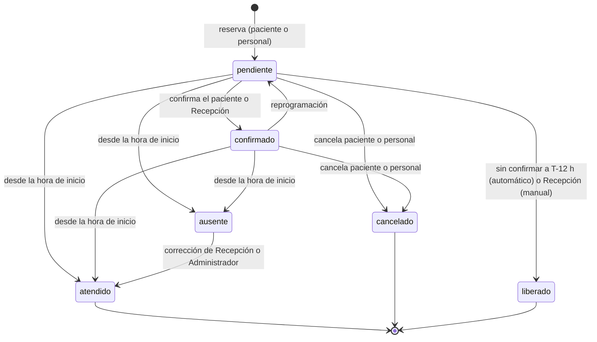
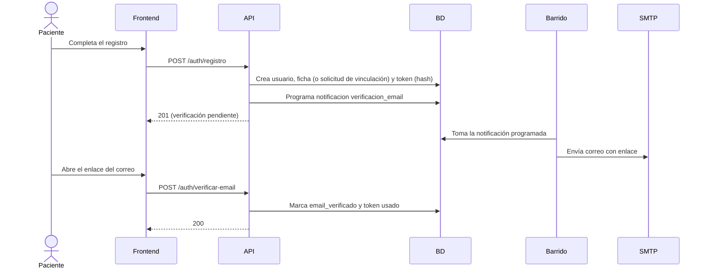
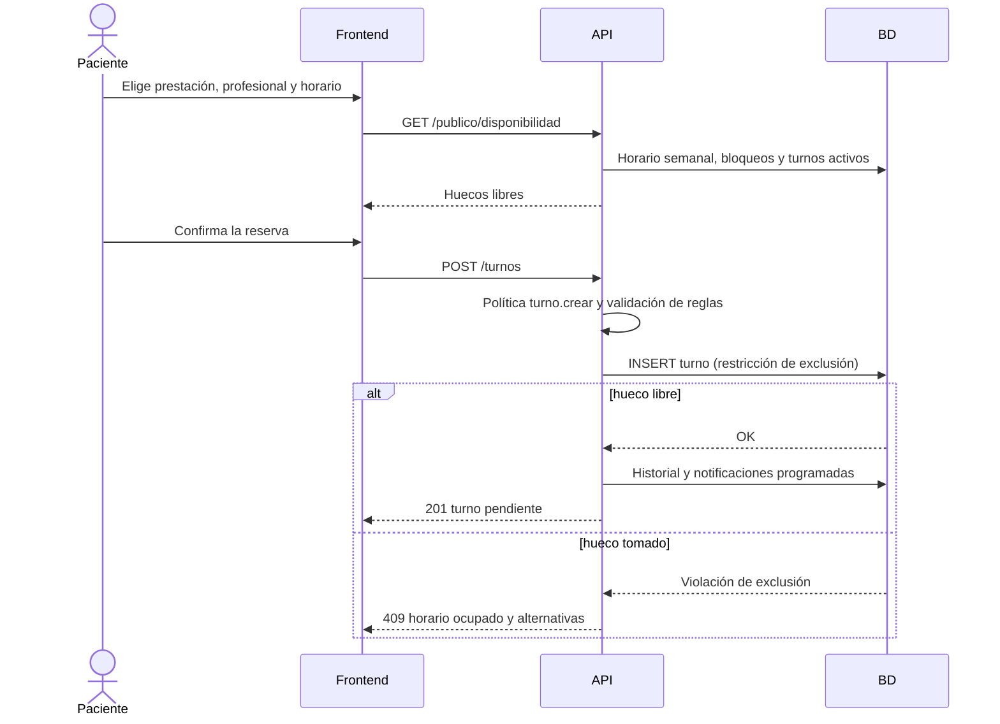
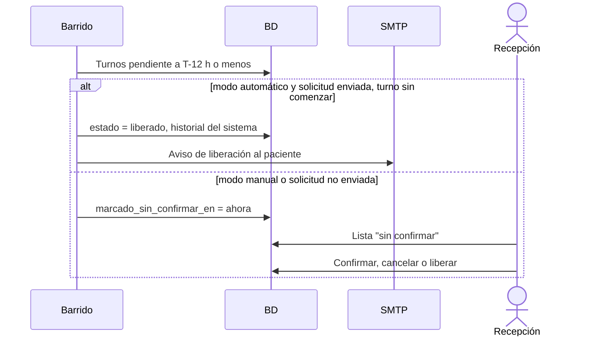
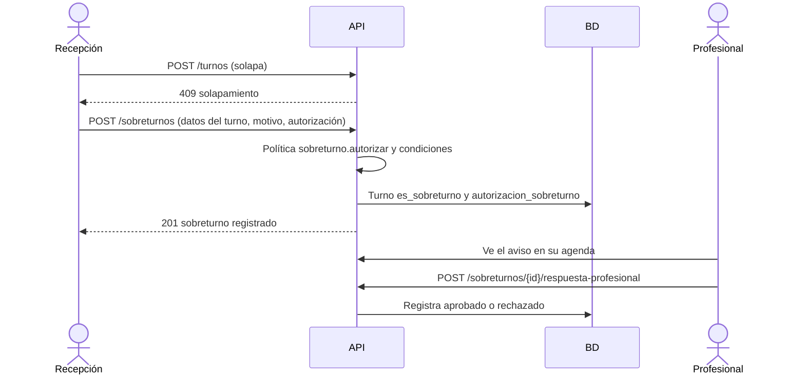

# Flujos Principales

Cada flujo se documenta extremo a extremo con los componentes que intervienen: **Frontend** (SPA), **API** (FastAPI), **BD** (PostgreSQL), **Barrido** (trabajo programado dentro de la API, activado por un disparador HTTP externo, con reclamación por fila en PostgreSQL), **SMTP** (servidor de correo) y los actores humanos. Las reglas citadas están en [05](05_reglas_de_negocio.md) y las políticas en [11](11_politicas_de_acceso_abac.md).

## Índice de flujos

| # | Flujo | Casos de uso | Reglas clave |
|---|-------|--------------|--------------|
| 1 | Registro de paciente y verificación de correo | CU-1 | RN-01 a RN-04, RN-47 a RN-49, RN-59, RN-62, RN-63 |
| 2 | Ingreso y recuperación de contraseña | CU-1 | RN-05, RN-06, RN-09, RN-59 |
| 3 | Reserva online | CU-1 | RN-13, RN-14, RN-17, RN-23, RN-24, RN-29 |
| 4 | Confirmación y recordatorio | CU-1, CU-2 | RN-25, RN-26, RN-30 |
| 5 | Liberación automática y modo manual | CU-2 | RN-27, RN-28, RN-22 |
| 6 | Cancelación y reprogramación | CU-1 | RN-32, RN-33, RN-34, RN-37 |
| 7 | Autorización de sobreturno | CU-3 | RN-39 a RN-43 |
| 8 | Marcado de atendido y ausente | CU-4 | RN-38, RN-44 |
| 9 | WhatsApp con un clic | CU-2 | RN-52 a RN-54 |
| 10 | Indicador de ausentismo | CU-5 | RN-44 a RN-46 |

## Ciclo de vida del turno

La marca "sin confirmar" del modo manual no es un estado: es `marcado_sin_confirmar_en` sobre un turno `pendiente` (RN-28).

## Flujo 1: Registro de paciente y verificación de correo

**Disparador**: una persona abre el enlace público de reserva y elige registrarse.
**Actor**: Paciente.

**Pasos**:
1. Frontend muestra el formulario: nombre y apellido, teléfono, correo, DNI, obra social (opcional), usuario y contraseña.
2. Frontend envía `POST /auth/registro` sin consultorio: la API lo resuelve con su configuración (RN-59). API aplica el límite de solicitudes por origen (el origen, su hash y el límite global cuando no hay origen están en RN-62 y DD-21; cada solicitud que pasa el límite deja un renglón en `intento_registro`, que se confirma antes de que empiece la transacción del registro, en la misma sesión, para que el intento cuente aunque después falle la validación o el registro) y valida formato y unicidad de usuario y correo dentro del consultorio. Un DNI ya existente no es un error de campo (RN-49).
3. API crea `usuario` (rol `paciente`, `email_verificado = false`, contraseña hasheada) e inserta la ficha de `paciente` con `INSERT ... ON CONFLICT (consultorio_id, dni) DO NOTHING`, de modo que la transacción sobreviva a un DNI repetido. Si insertó la ficha (DNI nuevo), el paciente reserva por su cuenta. Si no insertó nada (el DNI ya tiene ficha, con o sin cuenta, o la creó otro registro simultáneo), no crea una segunda ficha ni vincula: guarda una `solicitud_vinculacion` en estado `pendiente` con el DNI declarado (RN-49, RN-62). La respuesta y el correo de verificación son idénticos en ambos casos, de modo que el registro no dice si el DNI ya era paciente. Esto no cierra del todo la fuga: ver el caso de error de la reserva y las medidas que la acotan (RN-62, DD-19).
4. API genera un token de verificación de un solo uso, guarda su hash en `token_usuario` y programa el correo en `notificacion` (`verificacion_email`).
5. La API intenta enviar de inmediato el correo por SMTP (mismo caso de uso que el barrido; si falla, el siguiente barrido lo reintenta) con el enlace `FRONTEND_BASE_URL/verificar-email#token=...`. El token va en el fragmento de la URL y no en la query: el navegador no envía el fragmento al servidor ni en el encabezado `Referer`, así que no queda en los logs de acceso; la pantalla lo lee y lo envía en el cuerpo de un `POST`. Lo mismo vale para los enlaces de recuperación de contraseña y de confirmación de turno.
6. El paciente abre el enlace. Frontend envía `POST /auth/verificar-email`.
7. API valida el token (existe, no usado, no vencido; el consultorio sale de la fila del token, RN-59), marca `email_verificado` y `usado_en`.
8. Frontend redirige a `/login`.

**Pasos de la resolución de la solicitud de vinculación** (solo si el DNI ya tenía ficha):
1. Recepción (o Administrador) abre la lista de solicitudes (`GET /solicitudes-vinculacion?estado=pendiente`; sin el filtro de estado ve también las resueltas, para detectar intentos sospechosos como varias cuentas sobre el mismo DNI). La lista muestra el DNI declarado, el correo de la cuenta y si está verificado, y la ficha existente con ese DNI; en una solicitud `vinculada`, muestra la ficha vinculada. Al abrir una ficha (`GET /pacientes/{id}`), Recepción y Administrador ven la cuenta vinculada (identificador, nombre de usuario, correo y si está verificado) o nada si no tiene cuenta (RN-63).
2. Recepción verifica la identidad de la persona por un medio propio (por ejemplo, llamando al teléfono de la ficha).
3. Para vincular, `POST /solicitudes-vinculacion/{id}/vincular` con la ficha elegida (`paciente_id`): en una transacción, la API bloquea primero la fila de la ficha elegida (`SELECT ... FOR UPDATE` filtrado por `consultorio_id`; si no existe en el consultorio, responde 404 sin cambiar nada), pasa después la solicitud a `vinculada` y registra quién y cuándo (escritura condicional por el estado que Recepción vio) y después asigna el `usuario_id` de la solicitud a esa ficha (escritura condicional, `WHERE activo = true AND usuario_id IS NULL`): si cualquiera no afecta ninguna fila, se revierte todo y responde 409 sin cambiar nada, tampoco el estado de la solicitud. Eso incluye una solicitud ya `vinculada`, dos vínculos simultáneos sobre la misma ficha o de la misma solicitud con dos fichas, y la ficha inactiva o con otra cuenta; con el correo de la cuenta sin verificar también responde 409. Una violación de la unicidad de `paciente.usuario_id`, un interbloqueo o un fallo de serialización (`40P01`, `40001`) dentro de la transacción también se traduce a 409 con reversión completa. Para rechazar, `POST /solicitudes-vinculacion/{id}/rechazar` con un motivo opcional: si el correo de la cuenta está verificado, en la misma transacción se programa el correo `vinculacion_rechazada`, que le pide al paciente comunicarse con el consultorio sin decir por qué, y la API lo despacha de inmediato con el mismo caso de uso que el correo de verificación (si falla, el barrido lo reintenta); si el correo no está verificado, no se programa ningún correo.
4. Después de un rechazo, o cuando el DNI declarado era erróneo, el paciente llama al consultorio. Recepción vincula la cuenta con la ficha correcta (paso 3, que admite una solicitud `rechazada`) o crea una ficha nueva con `POST /pacientes` y la vincula. El paciente no reintenta por su cuenta ni hay un formulario nuevo para él: la salida depende de que contacte al consultorio.
5. Desde la vinculación el paciente puede reservar en línea con su ficha. Mientras la cuenta no tenga ficha (solicitud `pendiente` o `rechazada`, también tras una desvinculación) no puede reservar (costo aceptado de RN-62).

**Pasos para corregir un vínculo equivocado o bloqueado** (RN-63; Recepción o Administrador). Las acciones son `POST /pacientes/{id}/desvincular` (motivo obligatorio; la ficha conserva datos y turnos, la cuenta queda sin ficha con su solicitud en `rechazada`, sus sesiones renovables se revocan, sin correo; 409 si la ficha no tiene cuenta), `POST /pacientes/{id}/reactivar` (409 si ya está activa), `GET /solicitudes-vinculacion` (sin filtro de estado, para hallar la solicitud `rechazada` de una cuenta desvinculada), `POST /solicitudes-vinculacion/{id}/vincular` y `POST /solicitudes-vinculacion/{id}/rechazar`, `POST /pacientes` y `PATCH /pacientes/{id}`. Para saber qué cuenta tiene una ficha, Recepción abre `GET /pacientes/{id}` (cuenta vinculada); para saber qué ficha tiene una cuenta, mira su solicitud `vinculada` en la lista de solicitudes (ficha vinculada). Los cuatro casos:
- **Vínculo equivocado hecho por error** (la cuenta A quedó vinculada con la ficha F1 y le corresponde F2): (1) `POST /pacientes/{F1}/desvincular` con el motivo; (2) `POST /solicitudes-vinculacion/{solicitud de A}/vincular` con `paciente_id = F2`.
- **La ficha correcta ya tiene otra cuenta** (la solicitud de A apunta a F, que tiene la cuenta B): Recepción verifica quién corresponde. Si es B, `POST /solicitudes-vinculacion/{solicitud de A}/rechazar`. Si es A: (1) `POST /pacientes/{F}/desvincular` para B (B queda sin ficha y puede vincularse de nuevo con otra), (2) `POST /solicitudes-vinculacion/{solicitud de A}/vincular` con `paciente_id = F`.
- **La ficha correcta está inactiva**: (1) `POST /pacientes/{F}/reactivar`, (2) `POST /solicitudes-vinculacion/{solicitud}/vincular` con `paciente_id = F`.
- **Un tercero T se registró primero con un DNI nuevo y tiene su ficha F** (la persona correcta P se registra con ese DNI y queda con una solicitud `pendiente`): (1) `POST /pacientes/{F}/desvincular` para T (se crea la solicitud de T en `rechazada`); (2) `POST /turnos/{id}/cancelar` por cada turno que T haya reservado y no corresponda, antes de corregir la ficha para que el aviso de cancelación llegue al correo que la ficha tenía, el de T; (3) `PATCH /pacientes/{F}` para corregir los datos de la ficha; (4) `POST /solicitudes-vinculacion/{solicitud de P}/vincular` con `paciente_id = F`. T queda sin ficha y Recepción puede vincularla con otra o crearle la suya.

Una cuenta con el correo sin verificar no se puede vincular (409): hasta que lo verifique, o hasta que Recepción desvincule a la cuenta equivocada y vincule la de la persona correcta que se registró de nuevo, no reserva. Límite conocido: el token de acceso ya emitido de una cuenta desvinculada sigue válido hasta vencer (JD-12, sin corregir); no le da acceso a la ficha ni a sus turnos porque el token nunca lleva la ficha (RN-06) y la capa de aplicación carga el vínculo vigente en cada solicitud (RN-63).

**Casos de error**:
- Usuario o correo ya existentes → error de campo, sin revelar datos de otra persona más allá de lo necesario.
- DNI ya existente → no es un error: la respuesta es idéntica a la de un DNI nuevo y se crea la solicitud de vinculación (RN-49, RN-62).
- Dos registros simultáneos con el mismo DNI nuevo → el `INSERT ... ON CONFLICT (consultorio_id, dni) DO NOTHING` deja crear la ficha a uno; al otro no le inserta nada y sigue el camino de la solicitud de vinculación sin abortar su transacción. Los dos reciben la misma respuesta.
- Registros repetidos desde un mismo origen → se rechazan al superar el límite de solicitudes por origen (429); si no se puede determinar el origen, rige el límite global, también con 429.
- Paciente con la cuenta sin ficha (solicitud `pendiente` o `rechazada`) que intenta reservar → 403 con el mensaje de que debe comunicarse con el consultorio para verificar su cuenta; no se menciona el DNI ni el estado de la solicitud. Fuga residual aceptada (RN-62, DD-19): quien se registró con el DNI de otra persona y verificó su propio correo puede inferir de este 403 que ese DNI ya figuraba en el consultorio. Solo lo ve una cuenta con el correo verificado.
- Recepción intenta vincular una ficha que ya tiene otra cuenta, que está inactiva, o una cuenta con el correo sin verificar → 409 y la solicitud queda como estaba; Recepción resuelve cada caso con las acciones de arriba (rechazar, desvincular a la otra cuenta, reactivar la ficha).
- Dos Recepciones vinculan a la vez cuentas distintas con la misma ficha, o resuelven a la vez la misma solicitud (también si la vinculan con dos fichas distintas) → una prospera y la otra recibe 409 sin cambiar nada. Vincular una solicitud que ya está `vinculada` responde 409 desde el primer paso, sin tocar la ficha.
- Se rechaza una solicitud de una cuenta con el correo sin verificar → se rechaza sin correo; la cuenta, al verificar, ve el rechazo de la reserva (403).
- El DNI de la ficha cambió después de la solicitud → no hay conflicto: Recepción elige la ficha al vincular y el DNI declarado es solo informativo.
- Token vencido o ya usado → mensaje claro y opción de reenviar (`POST /auth/reenviar-verificacion`).
- Falla del SMTP → la notificación queda `fallida` y se reintenta de forma acotada (RN-31); el paciente puede pedir el reenvío.
- Intento de ingreso sin verificar → rechazo con opción de reenviar (RN-02).

## Flujo 2: Ingreso y recuperación de contraseña

**Disparador**: un usuario ingresa o pierde su contraseña.
**Actor**: cualquier rol.

**Pasos de ingreso**:
1. Frontend envía `POST /auth/login` con usuario y contraseña, sin consultorio: la API lo resuelve con su configuración (RN-59).
2. API inserta el intento y aplica la limitación (RN-09: cuenta los intentos del par cuenta y origen y los del origen; si superan el límite, responde el mismo 401 genérico sin verificar la contraseña), verifica el hash y, para pacientes, que el correo esté verificado.
3. API devuelve el JWT de acceso (usuario, `consultorio_id`, rol) y una sesión renovable (RN-06).
4. Frontend resuelve las pantallas según el rol.

**Pasos de recuperación**:
1. El usuario pide recuperar la contraseña. `POST /auth/recuperar-password` responde igual exista o no el correo (RN-05); el consultorio lo resuelve la API (RN-59).
2. Si la cuenta existe, API crea un token de un solo uso y la API intenta enviar el enlace de inmediato (si falla, el siguiente barrido lo reintenta).
3. El usuario abre el enlace y envía la nueva contraseña a `POST /auth/restablecer-password`.
4. API valida el token (el consultorio sale de la fila del token, RN-59), guarda el nuevo hash, marca el token como usado y revoca las sesiones activas.

**Casos de error**:
- Credenciales inválidas → mensaje genérico, se cuenta el intento.
- Par cuenta y origen bloqueado, o límite del origen alcanzado → el mismo 401 genérico, sin aviso de bloqueo; el bloqueo termina solo (RN-09, DD-25).
- Token de recuperación vencido o usado → se ofrece pedir uno nuevo.

## Flujo 3: Reserva online

**Disparador**: el paciente quiere un turno.
**Actor**: Paciente (con cuenta verificada).

**Pasos**:
1. Frontend consulta `GET /publico/prestaciones` y `GET /publico/profesionales` (el consultorio lo resuelve la API, RN-59).
2. El paciente elige prestación y profesional. Frontend consulta `GET /publico/disponibilidad`.
3. API calcula los huecos: horario semanal del profesional, menos excepciones, menos turnos activos (incluidos los sobreturnos activos, que cuentan como ocupado), con la duración de la prestación, con inicios cada `minutos_granularidad` desde el inicio de cada bloque y hasta `dias_anticipacion_maxima` días (RN-11 a RN-14, RN-17, RN-64).
4. El paciente elige un horario. Si no tiene sesión, ingresa o se registra (flujos 1 y 2) y vuelve a la elección.
5. Frontend envía `POST /turnos`. API aplica la política (`turno.crear`: paciente solo para sí, correo verificado).
6. En una sola transacción, API bloquea la fila del paciente (`SELECT ... FOR UPDATE` filtrado por `consultorio_id`), verifica que no tenga ya `max_turnos_activos_paciente` turnos activos (RN-64) e inserta el turno `pendiente` con `fin = inicio + duración` y el box del profesional. La restricción de exclusión de la BD resuelve la concurrencia (RN-24).
7. API registra en `turno_historial`, programa en `notificacion` los hitos de confirmación (T-48 h), recordatorio (T-24 h) y evalúa la liberación (T-12 h). Si faltan menos de `horas_confirmacion` para el inicio, el turno nace `confirmado`, no se programa la solicitud de confirmación y solo se programa el recordatorio si todavía no venció (RN-29).
8. API programa en `notificacion` el correo con el resumen del turno (`resumen_reserva`, aviso de algo que ya ocurrió: siempre vigente) y lo despacha.

**Casos de error**:
- Horario tomado entre la consulta y la reserva → 409 con alternativas (RN-24).
- Fuera de horario o sobre un bloqueo → 422 (RN-14).
- Horario fuera de la grilla o más allá de `dias_anticipacion_maxima` → 422; el paciente ya tiene el máximo de turnos activos → 409 con el máximo (RN-64).
- Horario cubierto por un sobreturno activo → 409 horario ocupado (RN-17; lo controla el caso de uso).
- Correo sin verificar → se ofrece el reenvío (RN-02).
- Cuenta sin ficha (solicitud de vinculación `pendiente` o `rechazada`) → 403 con el mensaje de que debe comunicarse con el consultorio para verificar su cuenta (RN-62).
- Reserva con menos de `horas_confirmacion` de anticipación → el turno se crea `confirmado` y sin solicitud de confirmación; los hitos vencidos se omiten (RN-29).

## Flujo 4: Confirmación y recordatorio

**Disparador**: el barrido detecta una notificación con `programada_para` vencida (T-48 h o T-24 h).
**Actor**: Sistema, Paciente y Recepción.

**Pasos de la solicitud de confirmación (T-48 h)**:
1. Mientras el tope diario de correos no se alcance (si se alcanzó, no reclama más y las filas siguen `programada`), el barrido reclama una por una las notificaciones `programada` vencidas (`SELECT ... FOR UPDATE SKIP LOCKED`, estado `enviando` y hora de reclamación, transacción corta confirmada antes de enviar; RN-61) y verifica que la notificación siga vigente según su tipo (tabla "Vigencia por tipo" en [04](04_modelo_de_datos.md): para la solicitud de confirmación, que el turno siga `pendiente`, en el mismo ciclo (RN-32) y sin comenzar); si no, pasa a `omitida`.
2. El barrido envía el correo con el enlace de confirmación (token de un solo uso, RN-30) fuera de toda transacción y en una segunda transacción corta registra el resultado (`enviada` y `confirmacion_solicitada_en`, o el reintento acotado y `fallida` de RN-31). Ese registro es una actualización condicional: solo se escribe si la fila sigue `enviando` con la misma `reclamada_en` que fijó este barrido; si otro barrido la retomó, el resultado se descarta sin escribir. Una reclamación vencida (barrido caído a mitad o envío más lento que el plazo) la revisa un barrido posterior, que antes revalida la vigencia del tipo (si ya no corresponde, la notificación pasa a `omitida`) y respeta el máximo de intentos (al alcanzarlo, `fallida` sin reenviar); solo reenvía si el tope diario no se alcanzó, y pasar a `omitida` o a `fallida` no se frena por el tope: la entrega es al menos una vez y un correo puede repetirse.
3. El barrido crea la notificación de canal WhatsApp en estado `preparada` con el texto y el enlace `wa.me` (flujo 9).
4. El paciente confirma desde su cuenta o desde el enlace del correo (en ese caso el consultorio sale de la fila del token, RN-59): la API pasa el turno a `confirmado`, registra `confirmado_en` y el historial.

**Pasos del recordatorio (T-24 h)**:
1. El barrido envía el recordatorio a los turnos `pendiente` y `confirmado` (RN-26). En los `pendiente` el texto advierte la liberación a las 12 horas solo si ese turno puede liberarse de forma automática según RN-60 (modo automático, solicitud de confirmación del ciclo actual `enviada`, sin marca y sin comenzar); en los demás casos el texto solo le pide que confirme, sin advertencia.
2. Se prepara el mensaje de WhatsApp correspondiente.

**Pasos de confirmación por el personal**:
1. Recepción confirma por teléfono o WhatsApp y marca el turno `confirmado` (`POST /turnos/{id}/confirmar`).

**Casos de error**:
- Falla de SMTP → reintento acotado y luego `fallida`, visible para Recepción (RN-31, US-035).
- El turno ya fue cancelado, liberado, confirmado (solo la solicitud de confirmación), reprogramado o ya comenzó → la solicitud de confirmación o el recordatorio se marca `omitida` según su vigencia por tipo; los avisos de liberación, de cambios del personal, de la reserva y de la cancelación del paciente no se omiten por eso: existen porque algo ocurrió.
- El paciente abre el enlace después de la liberación → mensaje de turno liberado y opción de reservar de nuevo.
- El enlace de confirmación vencido o usado → debe ingresar con su cuenta.

## Flujo 5: Liberación automática y modo manual

**Disparador**: el barrido detecta un turno `pendiente` a 12 horas o menos de su inicio.
**Actor**: Sistema y Recepción.

**Pasos en modo automático** (`modo_liberacion = automatico`):
1. El barrido selecciona los turnos `pendiente` con `inicio - horas_liberacion <= ahora` y `inicio > ahora` (todavía no comenzaron) en su ciclo actual y todavía sin la marca "sin confirmar". Un `pendiente` que ya comenzó queda fuera de la selección y no se reevalúa en cada barrido. Un turno que ya recibió la marca en ese ciclo no se vuelve a evaluar, aunque su solicitud de confirmación se envíe después: decide Recepción (RN-60).
2. Por cada turno, API ejecuta la transición a `liberado` con una sola actualización condicional (`WHERE estado = 'pendiente'`, sin marca, en el ciclo evaluado y `inicio > ahora`) en una transacción, con `liberado_en`, historial (actor: sistema) y hueco disponible (RN-22), solo si se cumplen las condiciones de RN-60: la solicitud de confirmación de su ciclo actual está `enviada` y el turno todavía no comenzó. Si no se cumplen y el turno no comenzó, el barrido le fija `marcado_sin_confirmar_en` con otra actualización condicional, con la misma guarda (acción `marcar_sin_confirmar` en el historial) y lo deja `pendiente` para que decida Recepción, como en el modo manual. En ambos casos la fila de historial se escribe en la misma transacción solo si la actualización afectó una fila, de modo que dos barridos simultáneos dejan una sola. Un turno que ya comenzó no está entre los candidatos ni recibe la marca: el personal lo marca `atendido` o `ausente` (RN-44).
3. Solo si la liberación afectó una fila, se programa el aviso de liberación; el barrido lo envía por correo al paciente (RN-27) y prepara el de WhatsApp.

**Pasos en modo manual** (`modo_liberacion = manual`):
1. El barrido marca el turno con `marcado_sin_confirmar_en` y lo deja `pendiente` (RN-28), con la misma selección y la misma guarda; un turno que ya comenzó no se selecciona (RN-44). Antes de la marca, Recepción también puede liberar un turno `pendiente` en modo manual.
2. Recepción ve la lista "sin confirmar" y, por cada turno, decide: llamar y confirmar, cancelar o liberar (`POST /turnos/{id}/liberar`).

**Casos de error**:
- El paciente confirma justo antes de la liberación → la transición es idempotente y condicional: solo libera si el estado sigue `pendiente`.
- Dos barridos simultáneos evalúan el mismo turno → solo una actualización condicional afecta la fila y se escribe una sola fila de historial.
- El turno se creó o se reprogramó con menos de `horas_confirmacion` de anticipación → nació `confirmado`, así que el barrido no lo selecciona: ni se libera ni recibe la marca "sin confirmar" (RN-29).
- La solicitud de confirmación del ciclo actual falló (`fallida`), fue omitida (`omitida`) o sigue `programada` o `enviando` → el turno no se libera: queda `pendiente` con la marca "sin confirmar" para que decida Recepción (RN-60).
- El turno ya comenzó (su inicio pasó antes del barrido, por ejemplo por un disparador caído) → queda fuera de la selección, nunca se libera de forma automática ni se reevalúa; el personal lo marca `atendido` o `ausente` (RN-60, RN-44).
- Falla del disparador externo o servicio dormido → al volver, el siguiente barrido procesa los vencidos sin duplicar (SU-26).

## Flujo 6: Cancelación y reprogramación

**Disparador**: el paciente o el personal cambian un turno.
**Actor**: Paciente, Recepción o Administrador.

**Pasos de cancelación por el paciente**:
1. Frontend muestra "Cancelar" solo si faltan 24 horas o más (RN-33). API lo verifica de nuevo (política A4).
2. API cambia el estado a `cancelado`, registra quién, cuándo y el motivo opcional (RN-36), libera el hueco y omite las notificaciones `programada` o `preparada` de solicitud de confirmación y de recordatorio que dejaron de estar vigentes ("Vigencia por tipo" en [04](04_modelo_de_datos.md)).
3. Se programa y envía la confirmación de la cancelación por correo (`cancelacion_por_paciente`, aviso de un hecho ya ocurrido: no se omite por el cambio del turno).

**Pasos de reprogramación por el paciente**:
1. El paciente elige un nuevo horario entre los disponibles.
2. API valida las reglas (RN-14, RN-17 y, para el paciente, la grilla y el límite de días de RN-64) y cambia el horario con una sola escritura sobre la misma fila del turno (RN-37); el turno conserva su duración actual (RN-64).
3. El turno vuelve a `pendiente` (o queda `confirmado` si el horario nuevo está a menos de `horas_confirmacion`, RN-29), se incrementa `ciclo_confirmacion`, se limpia `marcado_sin_confirmar_en` (la marca "sin confirmar" pertenece al ciclo anterior y sale de la lista de Recepción), las notificaciones `programada` o `preparada` de solicitud de confirmación y de recordatorio del ciclo anterior pasan a `omitida` en todos los canales ("Vigencia por tipo" en [04](04_modelo_de_datos.md)) y se reprograman los hitos (RN-32). El turno se evalúa de nuevo en su ciclo nuevo. Queda en el historial.

**Pasos por el personal**: igual, pero sin límite de 24 horas y mientras el turno no esté `atendido` (RN-34). Se avisa al paciente por correo y se prepara el mensaje de WhatsApp (US-034).

**Casos de error**:
- A menos de 24 horas, el paciente ve el mensaje con el teléfono del consultorio (RN-33).
- Nuevo horario ocupado → el turno original se mantiene (RN-37).
- Turno `atendido` → rechazado para todos los roles (RN-19).
- Un paciente intenta operar el turno de otro → 404 (RN-35).

## Flujo 7: Autorización de sobreturno

**Disparador**: Recepción necesita agendar sobre un horario ya ocupado de un profesional.
**Actor**: Recepción (o Administrador) y Profesional afectado.

**Pasos**:
1. Recepción intenta crear el turno. API detecta el solapamiento y rechaza el alta normal (RN-17).
2. Recepción elige "Autorizar sobreturno" e indica el motivo con la autorización explícita (RN-39, RN-41); el servidor registra el aviso al profesional en la misma operación (RN-40, DD-30).
3. API verifica la política `sobreturno.autorizar` y las condiciones (horario semanal y sin bloqueos, RN-43).
4. API crea el turno con `es_sobreturno = true` (queda fuera de la restricción de exclusión) y la fila de `autorizacion_sobreturno` con autorizante, fecha y aviso (RN-41).
5. El profesional recibe el aviso en su agenda y, si lo desea, aprueba o rechaza (`respuesta_profesional`). La respuesta queda registrada.
6. El turno se marca como sobreturno en todas las vistas (RN-42).

**Casos de error**:
- Paciente o Profesional intentan generar un sobreturno → 403 (RN-39).
- Fuera del horario del profesional o sobre un bloqueo → 422 (RN-43).
- Si el profesional rechaza, el sistema lo registra y lo muestra a Recepción; el sobreturno queda firme (no hay veto) y Recepción decide si lo cancela (RN-40, DD-30; Q-04 resuelta en [10](10_preguntas_abiertas.md)).

## Flujo 8: Marcado de atendido y ausente

**Disparador**: llega la hora del turno.
**Actor**: Profesional (propio), Recepción o Administrador.

**Pasos**:
1. El Profesional ve su agenda del día con el estado de cada turno (CU-4).
2. Si el paciente es atendido, marca `atendido`; si no se presenta, marca `ausente`. API verifica A1 (agenda propia), A3 (estado permitido) y A4 (hora de inicio alcanzada).
3. API cambia el estado y registra el historial con el actor.
4. Un turno `atendido` queda inmutable (RN-19). Si un `ausente` fue marcado por error, Recepción o Administrador lo corrigen a `atendido` y queda registrado.

**Casos de error**:
- Antes de la hora de inicio → rechazo (RN-44).
- Turno de otro profesional → 404: es un turno de otra agenda y revelar que existe expondría datos de otra persona (A1, regla de códigos de [11](11_politicas_de_acceso_abac.md)).
- Turno `cancelado` o `liberado` → no admite el cambio.

## Flujo 9: WhatsApp con un clic

**Disparador**: el barrido genera una notificación de canal WhatsApp (confirmación, recordatorio, liberación o cambio por el personal).
**Actor**: Recepción.

**Pasos**:
1. El barrido crea la `notificacion` con canal `whatsapp`, estado `preparada`, el texto del mensaje (RN-54) y el enlace `https://wa.me/<telefono>?text=<mensaje codificado>` con el teléfono normalizado (RN-53).
2. Recepción abre la lista "WhatsApp pendientes", ordenada por urgencia (hito más próximo primero).
3. Con un clic, el navegador abre WhatsApp (web o aplicación) con el chat y el texto prellenados.
4. Recepción envía el mensaje desde su WhatsApp y marca la notificación como enviada (`POST /notificaciones/{id}/marcar-enviada`). El estado pasa a `enviada_manual` y queda registrado quién.

**Casos de error**:
- Teléfono sin formato válido → se avisa a Recepción para corregir la ficha.
- Recepción no envía el mensaje → la notificación sigue `preparada` y visible; el sistema no puede verificar la entrega (riesgo registrado en [09](09_decisiones_y_supuestos.md)).
- El mensaje de solicitud de confirmación o de recordatorio dejó de estar vigente antes del envío (el turno cambió de estado o de ciclo, o ya comenzó) → la notificación se marca `omitida` y se retira de la lista; los mensajes de liberación y de cambios del personal no se omiten por eso.

## Flujo 10: Indicador de ausentismo

**Disparador**: el Administrador abre el indicador.
**Actor**: Administrador.

**Pasos**:
1. Frontend envía `GET /indicadores/ausentismo` con período y, opcionalmente, profesional.
2. API verifica la política `indicador.ausentismo` (solo Administrador).
3. API calcula sobre los turnos del período: cantidad de `ausente`, tasa `ausentes / (atendidos + ausentes)` (RN-45) y, por separado, cantidad de `liberado` y `cancelado`.
4. Frontend muestra totales, evolución por período y detalle por profesional.

**Casos de error**:
- Rol sin permiso → 403 (RN-46).
- Período sin turnos cuya hora haya llegado → se muestra sin tasa, sin dividir por cero.
- Turnos pasados sin marcar (siguen `pendiente` o `confirmado` después de su hora) → se informan como "sin cierre" para que el personal los marque; no se cuentan como ausentes.
